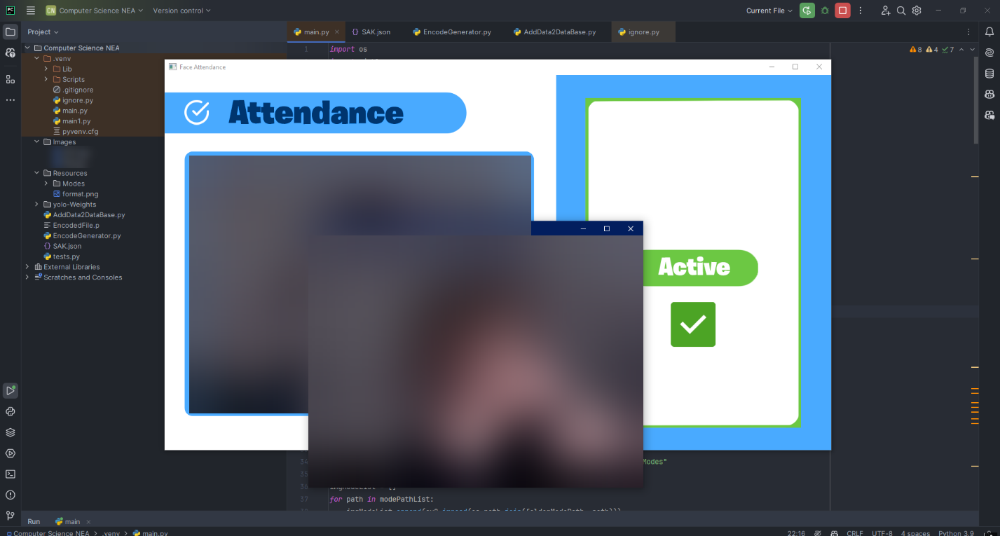
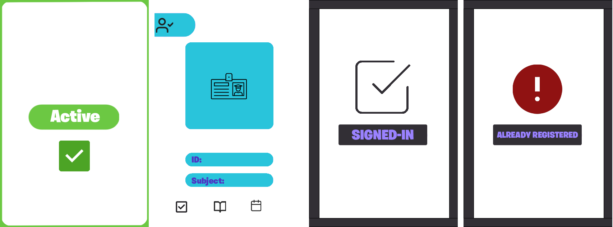
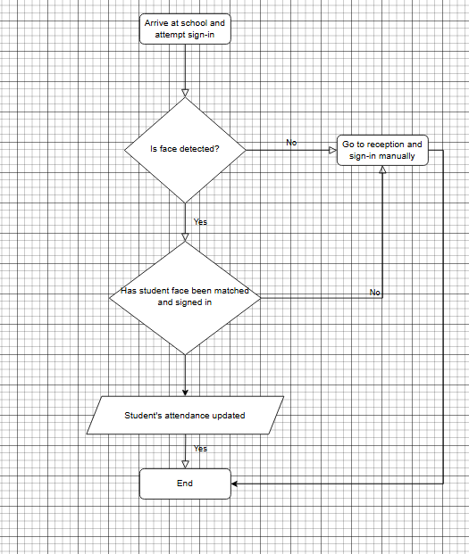
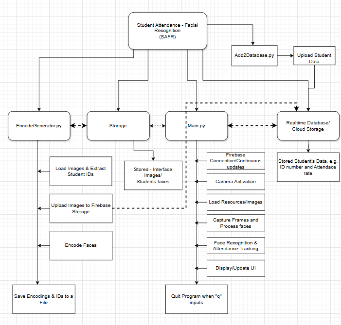

# Facial Recognition Attendance System

A real-time, hands-free sign-in system for sixth-form students. It replaces RFID ID cards with face recognition: a webcam identifies a student as they walk up, logs their attendance in a **Firebase Realtime Database**, and shows their record on a custom OpenCV interface within seconds.

Built as my **A-level Computer Science NEA** (Non-Exam Assessment, Year 13, 2024–25) in Python, using OpenCV, `face_recognition` (dlib) and Firebase.


<sub>The system running live. The camera feed has been blurred on purpose: no real faces are published in this repository.</sub>

---

## Contents

- [The problem](#the-problem)
- [How it works](#how-it-works)
- [Features](#features)
- [Tech stack](#tech-stack)
- [Project structure](#project-structure)
- [Getting started](#getting-started)
- [Data model](#data-model)
- [Design](#design)
- [Testing and results](#testing-and-results)
- [Known limitations](#known-limitations)
- [Future improvements](#future-improvements)
- [Privacy and security](#privacy-and-security)
- [Full write-up](#full-write-up)

---

## The problem

Sixth-form students sign in with RFID cards. These get lost, forgotten, snapped or demagnetised. Some students then queue at reception every morning and end up late to lessons. Accurate attendance also matters for safeguarding: in a fire alarm or lockdown, staff need to know who is on site.

A survey of students found the existing card system had a **mean satisfaction score of 43%**. Most complaints were about crashes, broken cards and the cost and wait of replacements.

## How it works

```
 ┌──────────────┐   ┌────────────────────┐   ┌───────────────────┐
 │ Images/*.png │──▶│ EncodeGenerator.py │──▶│ EncodedFile.p     │  128-d face encodings + IDs
 └──────────────┘   │  (one-off setup)   │   └───────────────────┘
                    │                    │──▶ Firebase Storage      student photos
                    └────────────────────┘
 ┌────────────────────┐
 │ AddData2DataBase.py│──────────────────────▶ Firebase Realtime DB  student records
 └────────────────────┘
                              ┌─────────────────────────────────────────────┐
 Webcam ─▶ main.py ─▶ detect │ face_locations → face_encodings → compare   │
                              │ nearest match? ─▶ fetch record + photo      │
                              │ >30 s since last sign-in? ─▶ increment      │
                              │ attendance + timestamp, else "already       │
                              │ registered"                                 │
                              └─────────────────────────────────────────────┘
```

1. **Enrolment.** `EncodeGenerator.py` reads one photo per student from `Images/`. It uploads each photo to Firebase Storage, computes a 128-dimensional face encoding with `face_recognition`, and pickles the encodings and student IDs to `EncodedFile.p`.
2. **Student records.** `AddData2DataBase.py` seeds the `Students` node of the Realtime Database with each student's name, subject, year, attendance count and last sign-in time.
3. **Live sign-in.** `main.py` captures webcam frames and downscales them to ¼ size for speed. It finds faces and compares them against the known encodings, taking the **minimum face distance** as the match.
   - **Known face:** the app draws a bounding box, fetches the student's record and photo from Firebase, and checks the time since their last sign-in. If more than 30 seconds have passed, it increments `Attendance` and updates `last_attendance_time` in real time. Otherwise it shows **"Already registered"**, which prevents duplicate entries.
4. **UI state machine.** A `modeType` / `counter` pair cycles the right-hand panel through *Active → Student details → Signed in → Already registered*, then resets.

## Features

- **Hands-free sign-in.** The student only has to look at the camera; there's nothing to tap or scan.
- **Real-time cloud sync.** Attendance updates appear in the Firebase console instantly.
- **Duplicate protection.** A 30-second cooldown stops repeat sign-ins.
- **Student info panel.** Shows the student's ID, subject, year, standing, start year, attendance count and stored photo.
- **Custom GUI.** The interface is built directly on OpenCV frames, with a background layout and four status panels.
- **Performance-aware.** Frames are processed at ¼ resolution to keep recognition responsive on modest hardware.

<p align="center"></p>

## Tech stack

| Area | Technology |
| --- | --- |
| Language | Python 3.9 |
| Computer vision | OpenCV (`opencv-python`), `cvzone` (UI overlays) |
| Face recognition | `face_recognition` (dlib ResNet face encodings) |
| Numerics | NumPy |
| Backend | Firebase Realtime Database and Firebase Storage via `firebase-admin` |
| Config | `python-dotenv` (secrets kept out of source control) |
| Persistence | `pickle` (serialised face encodings) |

## Project structure

```
facial-recognition-attendance/
├── main.py                 # Live recognition + attendance logging + GUI
├── EncodeGenerator.py      # Enrol students: encode faces, upload photos
├── AddData2DataBase.py     # Seed Realtime Database with student records
├── camera_test.py          # Stage 1 webcam smoke test
├── config.py               # Paths + Firebase settings loaded from .env
├── requirements.txt
├── .env.example            # Template for your own Firebase settings
├── Images/                 # Student photos (git-ignored, never published)
├── Resources/
│   ├── format.png          # Main UI background (1280×720)
│   └── Modes/1-4.png       # Right-hand status panels
└── docs/
    ├── WRITEUP.md          # Condensed NEA documentation
    └── images/             # Diagrams and screenshots
```

## Getting started

### Prerequisites

- Python 3.9+ and a webcam (720p or better recommended)
- `face_recognition` depends on **dlib**. On Windows, install CMake and the Visual Studio C++ Build Tools first, or install a prebuilt dlib wheel.
- A Firebase project with **Realtime Database** and **Storage** enabled

### Setup

```bash
git clone https://github.com/Raff407/facial-recognition-attendance.git
cd facial-recognition-attendance
python -m venv .venv
.venv\Scripts\activate          # macOS/Linux: source .venv/bin/activate
pip install -r requirements.txt
```

1. In the Firebase console, go to **Project settings → Service accounts → Generate new private key**. Save the key as `serviceAccountKey.json` in the project root. It's git-ignored.
2. Copy `.env.example` to `.env` and fill in your database URL and storage bucket.
3. Add one photo per student to `Images/`, named by student ID (for example `1001.png`).
4. Edit the sample records in `AddData2DataBase.py` so the keys match those IDs.

### Run

```bash
python AddData2DataBase.py   # 1. create student records
python EncodeGenerator.py    # 2. encode faces + upload photos
python main.py               # 3. start the sign-in kiosk (press q to quit)
```

## Data model

```json
{
  "Students": {
    "1001": {
      "Name": "Alex Example",
      "Subjects": "Computer-Science",
      "Year": 13,
      "Standing": "G",
      "Starting Year": "2018",
      "Attendance": 5,
      "last_attendance_time": "2024-03-07 00:54:34"
    }
  }
}
```

Photos are stored in Firebase Storage at `Images/<studentId>.png`.

## Design

| Flowchart | Structure diagram |
| :---: | :---: |
|  |  |

The full analysis, including competitor research, the stakeholder questionnaire, the IPSO table, the variable tables and the test plan, is in [docs/WRITEUP.md](docs/WRITEUP.md).

## Testing and results

Development ran in five stages, each with its own test table. All 20 planned tests passed. Details are in the [write-up](docs/WRITEUP.md#development).

| Stage | Focus | Result |
| --- | --- | --- |
| 1 | Webcam capture, display, quit and error handling | 5/5 ✅ |
| 2 | GUI background and overlay alignment | 3/3 ✅ |
| 3 | Encoding generation, serialisation, Firebase upload | 4/4 ✅ |
| 4 | Face detection, matching, unknown-face rejection | 3/3 ✅ |
| 5 | Database read/write, duplicate prevention, real-time sync | 4/4 ✅ |

A week-long trial with five student stakeholders produced these results:

- **Mean satisfaction rose from 43% to 72%.**
- **92%** of the year group (60+ students) preferred the face-recognition system, up from 70% in the first survey.
- Students who regularly forgot or broke their cards improved their attendance grades.

## Known limitations

These are findings from my own evaluation, published openly:

- **No liveness detection.** A photo of a student on a phone screen is accepted as that student. This was the most serious issue stakeholders found. The fix is anti-spoofing, using blink or motion checks or a depth or IR camera.
- **Speed.** Recognition is slower than tapping a card, because students have to hold still briefly.
- **UI bugs.** A second debug window (`Camera Test`) opens alongside the main UI, and student photos can appear squashed because they're resized to 216×216 without preserving aspect ratio.
- **Procedural structure.** The code is a set of procedural scripts. That suited a small project, but a `FaceRecognitionSystem` class would make it more modular.
- **Hosting cost.** Running it depends on a Firebase project.

## Future improvements

- Liveness and anti-spoofing checks
- Process every *n*th frame and run Firebase calls on a background thread to reduce UI lag
- Crop faces before encoding to cut computation
- A staff dashboard for manual overrides, plus email alerts when a student hasn't signed in
- Deploy on dedicated hardware, such as a Raspberry Pi with a camera at the building entrance
- Clearer variable names (for example `id` → `matched_student_id`, `cap` → `video_capture`)

## Privacy and security

Face data is sensitive biometric data, so this repository is deliberately scrubbed:

- **No credentials.** The Firebase service-account key, database URL and bucket name live in a local `.env` file and key file. Both are git-ignored.
- **No real faces or student data.** `Images/` and `EncodedFile.p` are git-ignored. Screenshots are blurred, and the sample records use fictional names.
- During the trial, Firebase security rules were configured to stop data being overwritten by anyone other than the service account.

## Full write-up

[docs/WRITEUP.md](docs/WRITEUP.md) condenses the full NEA report: analysis, design, five development stages, evaluation and reflection.

## Licence

[MIT](LICENSE)
