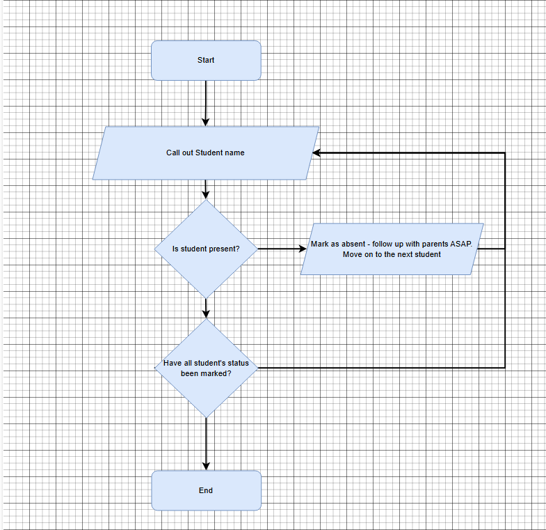
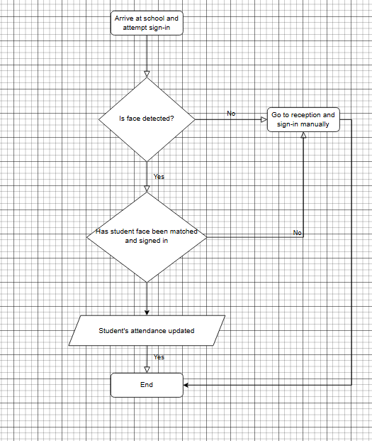
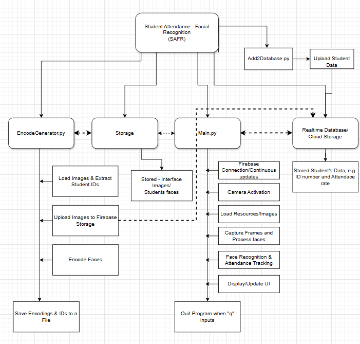
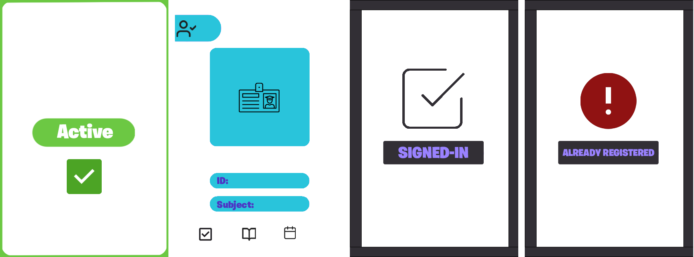
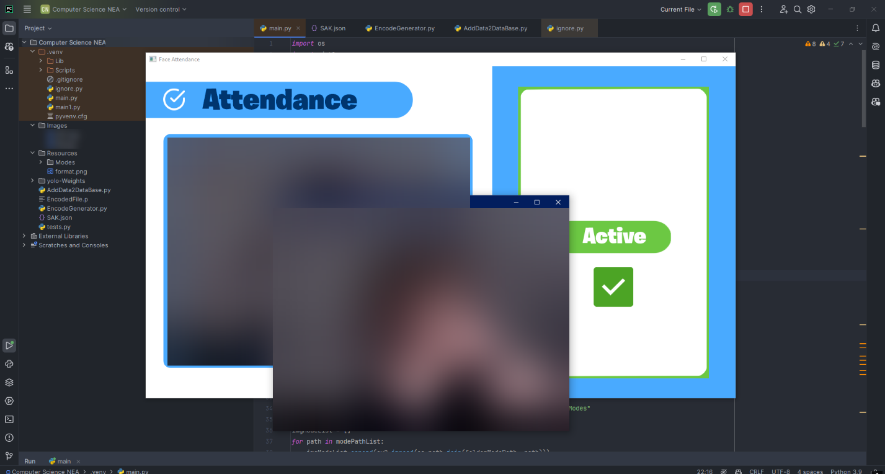
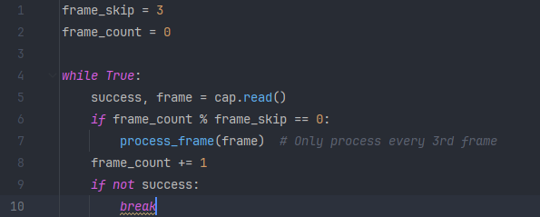

# Project Write-up: Facial Recognition Attendance System

*A condensed version of my A-level Computer Science NEA report (2024–25). Student names, IDs and the school's name have been removed; stakeholders appear as S1–S5.*

---

## Contents

1. [Analysis](#1-analysis)
2. [Design](#2-design)
3. [Development](#development)
4. [Evaluation](#4-evaluation)
5. [Reflection](#5-reflection)

---

## 1. Analysis

### 1.1 Problem

Sixth-form students sign in with RFID cards, which give them access to the school's register system. Cards are easily forgotten, lost, broken or demagnetised. When that happens, students have to sign in manually at reception, which makes them late and costs money in replacement cards. Accurate attendance is also a safeguarding requirement: in a fire alarm or lockdown, staff must know exactly who is on site.

### 1.2 Proposed solution

The proposed solution is a **facial-recognition sign-in kiosk** near the sixth-form entrance. It detects a student's face, matches it against a stored database and signs them in within seconds, with no card, no queue and no buttons. Industry reports suggest most colleges see improved security with biometric attendance.

### 1.3 Stakeholders

- **Primary:** sixth-form students (ages 16–18), who currently carry RFID cards.
- **Secondary:** teachers, reception staff and especially the safeguarding lead, who need accurate, real-time records of who is on site.

**Example scenario.** A student walks past the kiosk in the morning. The system is always on: it detects their face, matches it to a stored record and logs their attendance immediately. There's no stopping to scan a card, so forgotten cards no longer cause sign-in failures.

### 1.4 Existing solutions

| System | How it works | Pros | Cons |
| --- | --- | --- | --- |
| **EntrySign** | RFID card reader at reception | Cards are cheap, quick and identify the user's role | Cards get lost, snapped, demagnetised or cloned; replacements cost time and money |
| **Sign In App** | iPad kiosk where students sign themselves in | Saves lesson time; used by 6,000+ institutions | Manual entry lets anyone sign in anyone else (a safeguarding risk); about £450+ per stand |
| **Traditional register** | Teacher calls names one by one | Highly reliable, because the teacher sees each student | Slow; eats into every lesson's teaching time |

  
  
  

### 1.5 Limitations of the approach

A facial sign-in removes the need for lanyards. Sixth-formers can look like adult visitors, so staff could mistake them for strangers when they aren't wearing a lanyard. Other site-security measures may still be needed.

### 1.6 Computational methods

**Abstraction.** The system ignores everything in the camera frame except facial features, reducing each face to a 128-number encoding. That encoding is the only data needed to verify identity.

**Decomposition.** The problem was broken into independently buildable and testable parts:

| Sub-problem | Responsibility |
| --- | --- |
| User interface | Live feed and status panels so students know where to look and whether they're signed in |
| Image capture | Read frames from the webcam |
| Pre-processing | Downscale and convert frames (BGR → RGB) |
| Recognition | Compare live encodings against stored encodings |
| Database management | Store, view and edit student profiles and attendance |
| Sign-in logging | Record each successful sign-in with a timestamp |
| Encoding | Serialise known encodings to a file with `pickle` |

### 1.7 Hardware and software requirements

| Component | Minimum |
| --- | --- |
| Camera | 720p webcam at 24–30 fps or better, which balances detection reliability against cost and speed |
| Display | 11" or larger (iPad-sized, familiar to users) |
| CPU / RAM | Intel Core i3-6100 or equivalent, 4 GB RAM |
| GPU | Integrated (Intel HD 520 or equivalent) |
| Storage | 500 MB |
| OS | Windows 10 (64-bit) |
| Software | Python 3 with the required libraries, plus a Firebase Realtime Database |

### 1.8 Stakeholder research

I gave a questionnaire to students about the existing RFID system.

- Opinions were split. Some found cards convenient. Others reported the system **"always crashes"**, cards that **"never work"**, daily trips to reception and worries about cards being **cloned**.
- About 70% of a ten-person sample said they'd prefer a facial sign-in system.
- Privacy was the main concern. Students wanted to know where their data is kept, who can see it, how transparent the system is, and what happens if a parent refuses consent. One student also asked whether showing a **photo of another student** would work. That question later proved important.

### 1.9 Success criteria

| # | Criterion | Justification |
| --- | --- | --- |
| SC1 | **Accuracy and reliability.** Recognise students correctly with minimal false positives and negatives. | Inaccurate recognition would allow unauthorised sign-ins, which is a security flaw. |
| SC2 | **Security and data privacy.** Protect stakeholder data. | Needed for privacy-law compliance and trust. The code is open-sourced for transparency. |
| SC3 | **Efficiency and performance.** Sign-in completes within seconds. | A slow system discourages use. |
| SC4 | **Usability and integration.** Hands-free for students, and the database is easy to edit. | Hundreds of students use it daily, so it has to be effortless. |

---

## 2. Design

### 2.1 Flowchart and structure diagram

  
  

The structure diagram decomposes the system, called **Student Attendance – Facial Recognition (SAFR)**, into three scripts (`EncodeGenerator.py`, `AddData2DataBase.py` and `main.py`) and two cloud stores (Firebase Storage for photos and the Realtime Database for records). It also shows the sub-tasks each script performs.

### 2.2 User interface

The UI is a 1280×720 background with the live camera feed on the left and a swappable status panel on the right:

| Mode | Panel | Shown when |
| --- | --- | --- |
| 0 | **Active** | Waiting for a face |
| 1 | **Student details** | A face is matched, showing photo, name, ID, subject, year, standing and attendance |
| 2 | **Signed in** | Attendance has been logged |
| 3 | **Already registered** | The student signed in within the last 30 seconds |

### 2.3 IPSO

| Input | Process | Storage | Output |
| --- | --- | --- | --- |
| Continuous webcam feed | Encode each detected face and compare it to stored encodings until a match is found | Student records in the Firebase Realtime Database (Name, Subjects, Year, Standing, Starting Year, Attendance, last_attendance_time) | Database updated; UI shows "Signed in" or "Already registered" plus the student's details |
| `q` key | Break the main loop | Session changes are already saved in real time | Program closes |

The design deliberately keeps physical input to a minimum. Apart from the camera, the only input is `q` to shut the kiosk down after school hours.

### 2.4 Test plan (summary)

The plan covers camera detection, frame capture and display, quitting cleanly and handling a missing camera. It also covers background and overlay rendering, displaying student details, loading images, generating and saving encodings and uploading to Firebase. The recognition and database tests cover detecting a face, matching the right student and rejecting unknown faces. They also cover retrieving data, logging attendance, preventing duplicates and real-time database updates.

### 2.5 Key variables

| Script | Variable | Type | Purpose |
| --- | --- | --- | --- |
| all | `cred` | Firebase credential | Loads the service-account key |
| `AddData2DataBase.py` | `ref` | DB reference | Points to the `Students` node |
| | `data` | dict | Student records keyed by ID |
| `EncodeGenerator.py` | `imgList`, `studentIDs` | list | Loaded images and IDs taken from filenames |
| | `bucket`, `blob` | Storage objects | Upload photos to Firebase Storage |
| | `encodeListKnownWithIds` | list | `[encodings, ids]` pickled to `EncodedFile.p` |
| `main.py` | `cap` | `VideoCapture` | Webcam stream |
| | `imgS` | image | ¼-scale RGB frame for fast processing |
| | `faceCurFrame`, `encodeCurFrame` | list | Face locations and encodings in the current frame |
| | `matches`, `faceDistance`, `matchIndex` | list / int | Comparison results and best match |
| | `bbox` | tuple | Bounding box scaled back to full resolution |
| | `modeType`, `counter` | int | UI state machine and frame timer |
| | `studentInfo`, `imgStudent` | dict / image | Matched student's record and photo |
| | `secondsElapsed` | float | Time since last sign-in, for duplicate prevention |

---

## Development

### Stage 1: Camera input

**Goal.** Confirm OpenCV can open the webcam, display frames and exit on `q`. This stage is the input source for the whole system.

| Test | Expected | Result |
| --- | --- | --- |
| Open camera | Opens without error | ✅ |
| Capture a frame | Valid frame returned | ✅ |
| Display frame | Window shows live feed | ✅ |
| Press `q` | Window closes and program exits | ✅ |
| No camera available | Prints `Error: Camera not detected!` and exits | ✅ |

### Stage 2: Graphical user interface

**Goal.** Overlay the live feed and the status panels on a custom background using array slicing (for example `img_background[162:162+480, 55:55+640] = frame`), so students and staff can read sign-in status at a glance.

| Test | Expected | Result |
| --- | --- | --- |
| Load background | Displays without distortion | ✅ |
| Overlay alignment | Panels and feed positioned correctly | ✅ |
| Student details on recognition | Data visible | ✅ (completed in Stage 5) |

### Stage 3: Encode generator

**Goal.** Convert each student photo into a numerical face encoding, save all encodings with their IDs to a serialised file, and upload the photos to Firebase Storage. This makes live matching fast, because live frames are compared with precomputed encodings rather than raw images.

| Test | Expected | Result |
| --- | --- | --- |
| Load images from folder | All images read | ✅ |
| Generate encodings | No errors | ✅ |
| Serialise to file | Encodings stored correctly | ✅ |
| Upload to Firebase | Files visible in Storage | ✅ |

### Stage 4: Real-time recognition

**Goal.** Detect faces in each downscaled frame, compare them with the known encodings, take the **minimum face distance** as the candidate and accept it if `compare_faces` agrees. Then draw a bounding box (with the coordinates scaled ×4 back to full size) and record the matched ID.

| Test | Expected | Result |
| --- | --- | --- |
| Detect a face | Location identified | ✅ |
| Match a known face | Correct student | ✅ |
| Unknown face | Not recognised | ✅ |

### Stage 5: Database integration

**Goal.** On a match, fetch `Students/{id}` from the Realtime Database and the photo from Storage. Then compute the time since `last_attendance_time`:

- **More than 30 s:** increment `Attendance` and write the new timestamp.
- **Otherwise:** switch to the **Already registered** panel (duplicate prevention).

`AddData2DataBase.py` was also written to seed the database.

| Test | Expected | Result |
| --- | --- | --- |
| Retrieve student data | Correct record returned | ✅ |
| Log attendance | Count increments | ✅ |
| Prevent duplicates | Repeat sign-ins blocked | ✅ |
| Real-time sync | Console updates instantly | ✅ |

---

## 4. Evaluation

### 4.1 Stakeholder trial

Five students used the system for a school week, each with a different brief:

| Stakeholder | Brief | Outcome |
| --- | --- | --- |
| S1 | Try the new system | Signed in successfully. Was happy the old system already worked, but reassured by the security rules and liked seeing their attendance stats. |
| S2 | Sign in every day for a week | Signed in every day; attendance grade improved from D to C. Found it more reliable than the old system but slower, and asked for faster detection. |
| S3 | Sign in daily until their grade improves | Attendance grade rose from D to C+, with no more late arrivals caused by forgotten cards. **Found that a photo of their face on a phone signed them in.** |
| S4 | Report honest feedback | Signed in every day; no longer needed reception or replacement cards. Raised accessibility for different religious and cultural dress. |
| S5 | Look for security flaws | **Confirmed photo spoofing:** a phone photo of another student signs that student in without their knowledge. |

### 4.2 Quantitative results

| Measure | Old system | New system |
| --- | --- | --- |
| Mean satisfaction (5 stakeholders) | 43% | **72%** (+29 points) |
| Prefer facial recognition | 70% (10 students) | **92%** (60+ students, whole year group) |

Satisfaction rose sharply for the students who'd struggled with cards (one went from 5% to 100%). It fell for the two who were happy with cards or concerned about security. That's a useful reminder that one system rarely suits everyone.

### 4.3 Success criteria assessment

| Criterion | Verdict | Evidence |
| --- | --- | --- |
| SC1 Accuracy and reliability | 🟡 Partial | Every enrolled student was identified correctly and unknown faces were rejected, but the system **can't distinguish a live person from a photo**. |
| SC2 Security and privacy | 🟡 Partial | Keys were kept private and console rules prevented overwrites, but photo spoofing remains an attack vector. |
| SC3 Efficiency and performance | 🟢 Met | Matching runs continuously in real time. The display refresh is throttled so lower-powered kiosk hardware isn't overloaded. |
| SC4 Usability | 🟢 Met | Fully hands-free. Students just face the camera and can see their own attendance data. |

### 4.4 GUI feedback

Feedback on the interface was positive overall. Students described it as simple and familiar, and said they never had to touch anything. They reported two bugs:

1. A second debug window (**Camera Test**) sometimes appeared on first launch.
2. Student photos could look **squashed**, because they're forced into a 216×216 box regardless of aspect ratio.

The dual-window bug. Camera feeds are blurred for privacy.

---

## 5. Reflection

### Hardware

I planned a standalone kiosk built on a Raspberry Pi and camera at the entrance. Budget limited the project to a program on a PC, but the design ports easily to embedded hardware later.

### Maintainability

The code is commented by block so each section is easy to find. With hindsight, I'd add docstrings and clearer variable names (`id` → `matched_student_id`, `cap` → `video_capture`, `counter` → `frame_counter`). Long-term running costs depend on Firebase hosting.

### Performance improvements

- Process every 3rd to 5th frame instead of every frame, because recognition is computationally expensive:

  

- Run Firebase reads and writes on a separate thread to stop UI stalls.
- Crop the detected face before encoding, so the whole frame isn't processed.

### Why procedural rather than OOP

The program is small, sequential and event-driven (*capture → detect → match → update*), so procedural scripts kept it simple. If I extended it, I'd encapsulate the logic in a `FaceRecognitionSystem` class to separate detection, encoding and database access.

### Features I'd add

- **Liveness detection** to defeat photo spoofing (the top priority)
- A staff-only manual override, which also covers outages
- Real-time email alerts to teachers when a student hasn't signed in
- An RFID fallback

### Open source

Publishing the code invites community fixes for false positives, speed and spoofing. It also gives students and parents transparency about exactly how their data is handled, which directly addresses the privacy concerns raised in the questionnaire.
